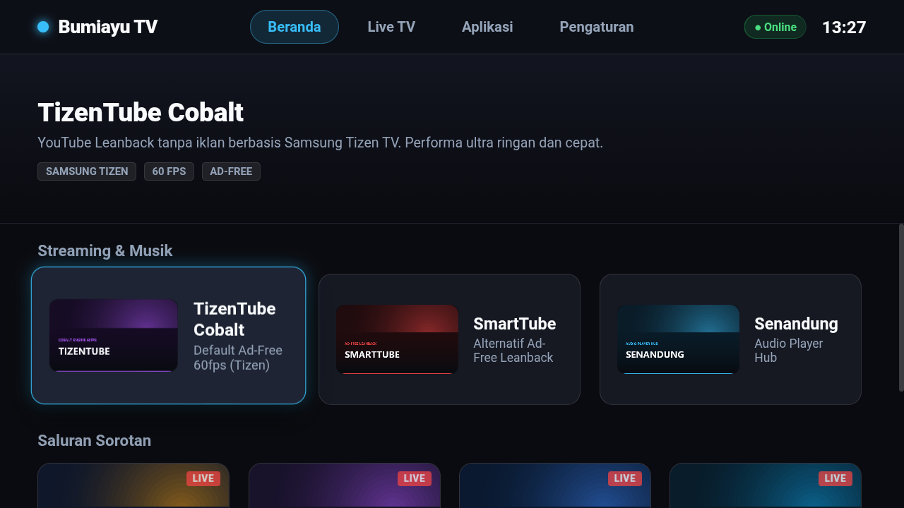
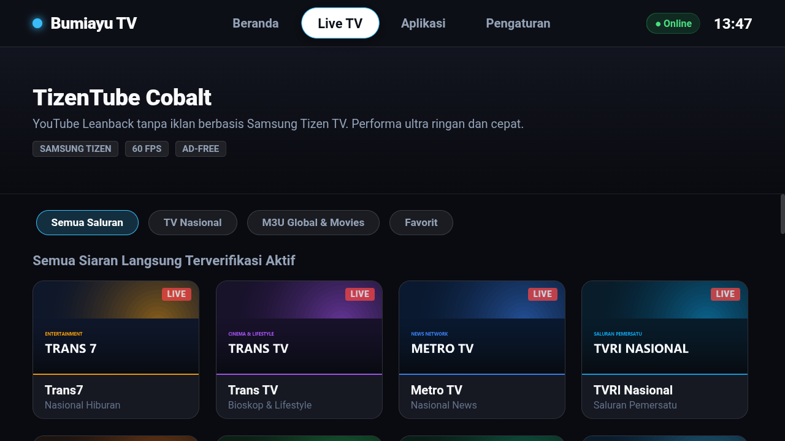
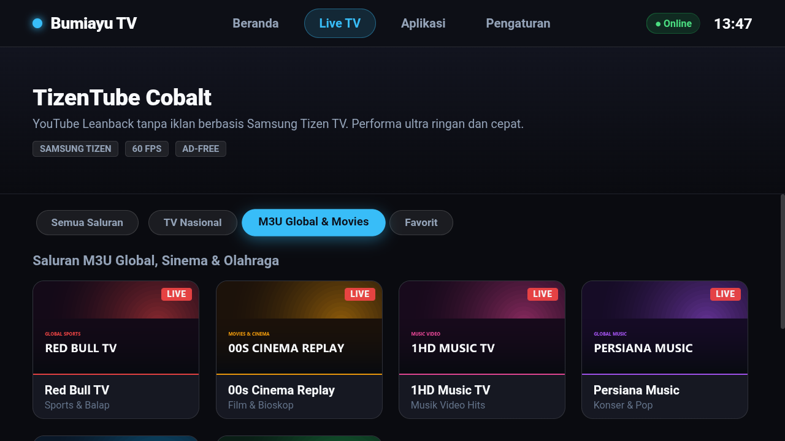
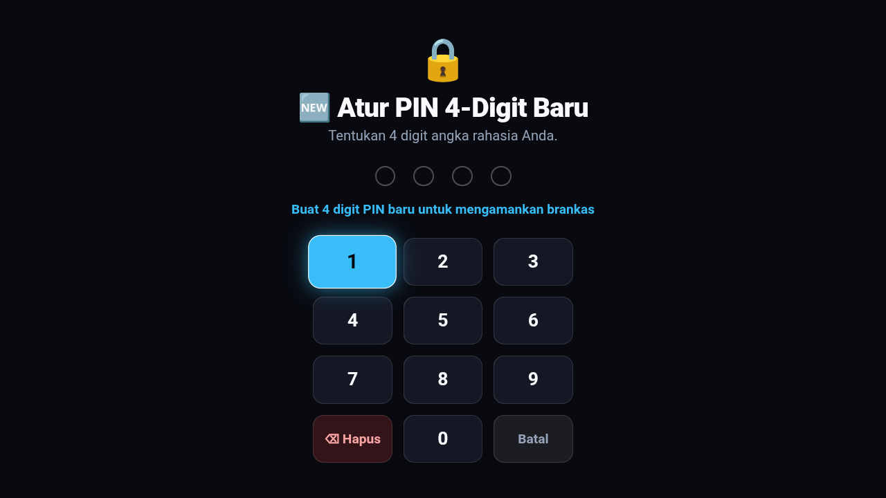
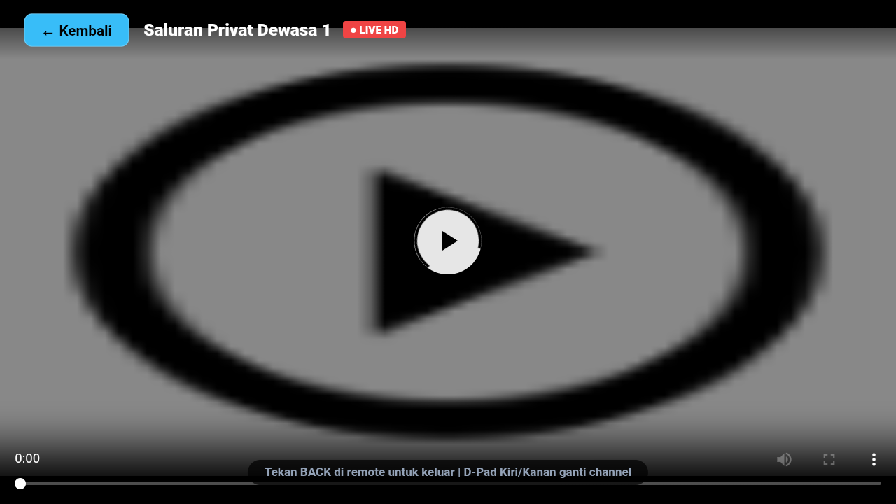

# 📺 Bumiayu TV Launcher (Google TV Modern Edition)

[-brightgreen.svg)](https://developer.android.com)
[-blue.svg)](#cross-platform-architecture)

Launcher Android TV modern, ultra-ringan, dan sinematik yang dirancang khusus untuk smart TV spesifikasi terbatas (seperti Xiaomi Smart TV 4A 32" RAM 1GB / Mali-450 GPU) maupun perangkat Android TV Box terkini. Mengusung antarmuka bergaya **Google TV / Apple TV**, navigasi remote 2D spasial penuh, pemutar live streaming HLS anti-buffering, dan brankas privasi terproteksi PIN 4-digit.

---

## 📸 Tampilan Visual Antarmuka (Live TV Screenshots)

Berikut adalah tangkapan layar langsung (*live capture*) antarmuka aplikasi dari Xiaomi Smart TV:

### 1. Beranda Sinematik (Cinematic Hero Billboard & Hub)
Tampilan katalog utama dengan poster format layar lebar 16:9, sorotan siaran dinamis, serta integrasi pemutar YouTube tanpa iklan (TizenTube Cobalt default 60fps & SmartTube alternatif).

---

### 2. Tab Live TV dengan Sekat Sub-Kategori (Toolbar Filter)
Navigasi saluran televisi terpadu dengan sekat sub-filter yang memudahkan beralih antara **Semua Saluran**, **TV Nasional**, **M3U Global & Movies**, dan **Favorit**.

---

### 3. Saluran M3U Global, Sinema & Olahraga
Koleksi siaran film bioskop, olahraga ekstrem (Red Bull TV), musik video 24 jam (1HD Music TV, Persiana), dan dokumenter beresolusi tinggi yang terverifikasi aktif.

---

### 4. Brankas Privasi 18+ (Dedicated Apple TV PIN Screen)
Layar kunci independen penuh ala Apple TV / Netflix profile. Dilengkapi 4 bulatan PIN (`○ ○ ○ ○`) dan keypad D-Pad untuk melindungi saluran privat dewasa.

---

### 5. Pemutar Video Fullscreen 100% Bersih
Pemutaran video HLS siaran langsung layar penuh tanpa adanya dialog melayang atau tombol keypad yang menghalangi konten.

---

## ⚡ Fitur Unggulan

- **🎬 Desain Sinematik Anti "AI-Slop":**
  - Tipografi tajam kontras tinggi standar WCAG AA (`#f8fafc`).
  - Shimmer light reflection halus saat kartu mendapat sorotan remote.
  - Zero `backdrop-filter: blur()` untuk menjamin performa rendering tetap 60fps pada CPU/GPU TV hemat daya.
- **🧭 Navigasi 2D Spasial Akurat:**
  - Navigasi D-Pad bertingkat per-rak (*per-shelf grid*) yang mencegah lompatan fokus langsung ke tab bar atas dari baris bawah.
- **📡 Multi-Source HLS Streaming Engine:**
  - Dilengkapi buffer throttling cerdas (30MB memory cap) untuk mencegah lag dan buffering di RAM terbatas.
  - Mendukung 36+ saluran TV nasional (Trans7, Trans TV, Metro TV, TVRI Nasional & Daerah, RTV, Nusantara TV, Jawa Pos TV, TV9 Nusantara, BRTV, dll.) dan saluran M3U global aktif.
- **🛡️ Stealth Privacy Vault 18+:**
  - Konten dewasa otomatis disaring dan disembunyikan total dari katalog publik, hanya dapat diakses melalui verifikasi PIN 4-digit pribadi.
- **🌍 Universal Cross-Platform ABI:**
  - Mendukung instalasi 1-klik di seluruh arsitektur Android: **ARMv7 (32-bit)**, **ARM64 (64-bit)**, **x86 (32-bit emulator/Intel TV)**, dan **x86_64**.

---

## 📂 Aturan Pengembangan & Rilis

Untuk panduan mendalam mengenai arsitektur launcher, silakan baca dokumentasi proyek:
- [📄 SOP Versioning Proyek](VERSIONING_RULES.md) — Aturan penomoran versi `Main.Beta.NightlyDev` (`X.Y.Z`).
- [🎨 Standar Rendering & Performa](RENDER_RULES.md) — Panduan teknis rendering CSS, HLS buffer, dan rasio poster.
- [📝 Log Perubahan Lengkap](CHANGELOG.md) — Riwayat lengkap perbaikan bug dan penambahan fitur dari setiap rilis.

---

## 📥 Unduh APK Terbaru

Unduh build APK otomatis langsung dari GitHub Actions Artifacts:
- **[Download APK Bumiayu TV Launcher Terbaru (nightly.link)](https://nightly.link/faisalfa123/bumiayu-tv/workflows/build-apk/main/BumiayuTVLauncher-APK.zip)**
