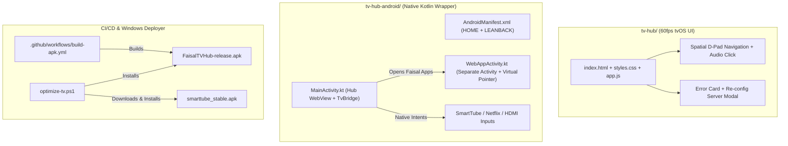

# Custom Animated Apple TV Hub & Faisal Ecosystem Implementation Plan

> **For agentic workers:** REQUIRED SUB-SKILL: Use superpowers:subagent-driven-development (recommended) or superpowers:executing-plans to implement this plan task-by-task. Steps use checkbox (`- [ ]`) syntax for tracking.

**Goal:** Build a custom, 60fps Apple TV-style animated Hub APK (`FaisalTVHub`) integrating `Senandung`, `Immich`, `DompetMungil` (with on-TV server re-configuration UI and D-Pad virtual mouse), **SmartTube Stable** (ad-free YouTube), streaming apps, and HDMI inputs, plus an upgraded Windows ADB deployment script.

**Architecture:** Because the Windows host has Node.js but no local Android SDK/JDK, the Hub UI is built as a lightweight, hardware-accelerated HTML5/CSS/JS frontend (`tv-hub/`) paired with a native Kotlin Android TV Leanback wrapper (`tv-hub-android/`) featuring a `HOME` intent, `TvBridge` JS interface (for launching SmartTube, Netflix, and HDMI inputs), a separate `WebAppActivity` with a D-Pad Virtual Pointer overlay, and a GitHub Actions workflow to compile the signed/release APK cleanly in the cloud. Simultaneously, `optimize-tv.ps1` is upgraded to auto-download and install **SmartTube Stable** and deploy the Hub.

**Architecture Diagram:**

**Tech Stack:** HTML5/CSS3/Vanilla JS (zero framework overhead for 1GB RAM), Node.js (local preview & tests), Kotlin (Android TV SDK 33 / MinSDK 21), GitHub Actions, Windows PowerShell 5.1+.

**Spec:** [2026-11-18-custom-hub-faisal-apple-tv-design.md](file:///C:/Users/user/.gemini/antigravity/scratch/xiaomi-tv-debloat/docs/superpowers/specs/2026-11-18-custom-hub-faisal-apple-tv-design.md)

## Global Constraints
- Must run smoothly at 60fps on Xiaomi Smart TV 4A (1 GB RAM, Mali-450 GPU): avoid heavy live `backdrop-filter: blur()` on full-screen layers; use GPU-composited `transform: scale(1.08)` and `opacity` transitions.
- Separate Android Activity (`WebAppActivity`) for Faisal's self-hosted PWAs (`Senandung`, `Immich`, `DompetMungil`) so pressing Back immediately frees RAM.
- Graceful Error UI: On `onReceivedError` / timeout, show clean tvOS card with "Coba Lagi" and "Re-konfigurasi Alamat Server" buttons.
- Integrated D-Pad Virtual Pointer in `WebAppActivity` so standard TV remotes can click web buttons.
- SmartTube Stable (`com.teamsmart.videomanager.tv`) auto-downloaded and installed by `optimize-tv.ps1`.

## Review Focus
1. Focus trap in Re-configuration modal: When the server error modal opens, D-Pad focus must stay trapped inside the modal until dismissed or saved.
2. Offline / unreachable local server: Timeout or `ERR_CONNECTION_REFUSED` must cleanly trigger the custom error overlay instead of Android's default ugly WebView error page.
3. Missing native app intent: Clicking Netflix/Prime/SmartTube when an app isn't installed must show a clean toast/notice instead of crashing the launcher.
4. Virtual Pointer bounds: Moving the D-Pad cursor in `WebAppActivity` must clamp within screen width/height and not go off-screen.
5. PowerShell download failures: If GitHub download for SmartTube fails or times out, `optimize-tv.ps1` must catch the error gracefully and continue with remaining steps.

---

### Task 1: Custom Animated Apple TV Hub Frontend (`tv-hub/`)

**Files:**
- Create: `C:/Users/user/.gemini/antigravity/scratch/xiaomi-tv-debloat/tv-hub/index.html`
- Create: `C:/Users/user/.gemini/antigravity/scratch/xiaomi-tv-debloat/tv-hub/styles.css`
- Create: `C:/Users/user/.gemini/antigravity/scratch/xiaomi-tv-debloat/tv-hub/app.js`

**Interfaces:**
- Consumes: `window.TvBridge` (native Android interface when running on TV, or mocked fallback when previewing in browser) and `localStorage` key `faisal_tv_apps_config`.
- Produces: Complete tvOS-styled Hub with 3 rows (Faisal's Apps, Media & SmartTube, Hardware Inputs & Settings), live clock, D-Pad spatial navigation, audio click feedback, and Server Re-configuration Modal.

- [ ] **Step 1: Create `tv-hub/index.html`**
Structure the semantic HTML5 layout with:
- Header bar: Brand title ("Faisal TV"), live digital clock & Indonesian date, Wi-Fi/Hub status pill.
- Row 1 (`Faisal's Ecosystem`): Cards for `Senandung`, `Immich`, `DompetMungil` with `data-app-id` and `data-row="0"`.
- Row 2 (`Hiburan & Streaming`): Cards for `SmartTube` (Ad-Free), `Netflix`, `Prime Video` with `data-row="1"`.
- Row 3 (`Input TV & Pengaturan`): Cards for `HDMI 1`, `HDMI 2`, `AV`, `Pengaturan TV`, `Konfigurasi Server` with `data-row="2"`.
- Modal overlay (`#reconfig-modal`): Form inputs for Senandung URL, Immich URL, DompetMungil URL, and Save/Cancel buttons.
- Toast notification element (`#toast`).

- [ ] **Step 2: Create `tv-hub/styles.css`**
Implement GPU-composited Apple TV aesthetic:
- Deep dark gradient background (`#0b0e14` to `#141923`).
- Card styling with `will-change: transform`, `transition: transform 180ms cubic-bezier(0.2, 0.8, 0.2, 1.0), box-shadow 180ms ease`.
- `.card.focused` state: `transform: scale(1.08)`, soft white border glow (`0 12px 32px rgba(0,0,0,0.6), 0 0 0 3px rgba(255,255,255,0.85)`).
- Subtle floating ambient background glow without heavy `backdrop-filter`.
- Clean modal styling for `#reconfig-modal` and `#toast`.

- [ ] **Step 3: Create `tv-hub/app.js`**
Implement:
- `DEFAULT_CONFIG` for `senandung`, `immich`, `dompetmungil` (stored/loaded from `localStorage`).
- Live clock updater (`setInterval` every 1000ms).
- Web Audio API soft click synthesizer (`playFocusSound()`) for Apple TV navigation feel.
- 2D Spatial D-Pad Grid Navigator handling `ArrowLeft`, `ArrowRight`, `ArrowUp`, `ArrowDown`, `Enter`, and `Escape`/`Backspace` (including focus trapping when `#reconfig-modal` is open).
- `launchWebApp(appId)` calling `window.TvBridge.openWebApp(name, url, appId)` if on Android, or `window.open` fallback in browser preview.
- `launchNativeApp(pkgName)` and `launchTvInput(inputType)` calling `window.TvBridge` with graceful toast if unavailable.

- [ ] **Step 4: Verify `tv-hub/` syntax and JS logic**
Run Node.js syntax check and unit test for navigation/config logic.

---

### Task 2: Native Android TV Leanback Launcher & Virtual Pointer (`tv-hub-android/`)

**Files:**
- Create: `C:/Users/user/.gemini/antigravity/scratch/xiaomi-tv-debloat/tv-hub-android/settings.gradle.kts`
- Create: `C:/Users/user/.gemini/antigravity/scratch/xiaomi-tv-debloat/tv-hub-android/build.gradle.kts`
- Create: `C:/Users/user/.gemini/antigravity/scratch/xiaomi-tv-debloat/tv-hub-android/app/build.gradle.kts`
- Create: `C:/Users/user/.gemini/antigravity/scratch/xiaomi-tv-debloat/tv-hub-android/app/src/main/AndroidManifest.xml`
- Create: `C:/Users/user/.gemini/antigravity/scratch/xiaomi-tv-debloat/tv-hub-android/app/src/main/java/com/faisal/tvhub/MainActivity.kt`
- Create: `C:/Users/user/.gemini/antigravity/scratch/xiaomi-tv-debloat/tv-hub-android/app/src/main/java/com/faisal/tvhub/WebAppActivity.kt`
- Create: `C:/Users/user/.gemini/antigravity/scratch/xiaomi-tv-debloat/tv-hub-android/app/src/main/java/com/faisal/tvhub/VirtualPointerView.kt`
- Create: `C:/Users/user/.gemini/antigravity/scratch/xiaomi-tv-debloat/tv-hub-android/app/src/main/assets/error.html`
- Create: `C:/Users/user/.gemini/antigravity/scratch/xiaomi-tv-debloat/.github/workflows/build-apk.yml`

**Interfaces:**
- Consumes: `tv-hub/` assets copied into `app/src/main/assets/hub/`.
- Produces: Compilable Android TV Kotlin project + GitHub Actions workflow that outputs `FaisalTVHub-release.apk`.

- [ ] **Step 1: Create Gradle & AndroidManifest configuration**
Configure `compileSdk = 33`, `minSdk = 21`, `targetSdk = 33`, `INTERNET` permission, `usesCleartextTraffic="true"` (crucial for local `http://192.168.x.x` SBC servers!), and `LEANBACK_LAUNCHER` + `HOME` intent filters on `MainActivity`.

- [ ] **Step 2: Create `MainActivity.kt` with `TvBridge`**
Host the Hub `WebView` loading `file:///android_asset/hub/index.html`, expose `@JavascriptInterface` methods:
- `openWebApp(appName: String, url: String, appId: String)` -> launches `WebAppActivity`
- `launchApp(packageName: String)` -> launches external app (SmartTube, Netflix, Prime) via `PackageManager.getLeanbackLaunchIntentForPackage` / `getLaunchIntentForPackage` with safe fallback toast
- `openTvInputs()` / `openSettings()` -> triggers Android TV input picker (`android.media.tv.action.VIEW_INPUTS` / `Settings.ACTION_SETTINGS`).

- [ ] **Step 3: Create `VirtualPointerView.kt` and `WebAppActivity.kt`**
- `VirtualPointerView`: Lightweight custom `View` drawing a crisp circular tvOS-style pointer with shadow, clamped to screen bounds.
- `WebAppActivity`: Dedicated `Activity` for `Senandung`, `Immich`, and `DompetMungil`:
  - Intercepts D-Pad `KEYCODE_DPAD_*` to move the pointer smoothly (accelerated step on hold) and `KEYCODE_DPAD_CENTER` / `KEYCODE_ENTER` to dispatch `MotionEvent.ACTION_DOWN` + `ACTION_UP` at pointer coordinates.
  - Toggleable pointer mode vs scroll mode via Menu/Long-press or edge scrolling.
  - Intercepts `onReceivedError` / `onReceivedHttpError` (status >= 500 or connection failed) and loads `file:///android_asset/error.html` passing the failed `appId` and `url`.
  - `error.html` provides **"Coba Lagi"** and **"Re-konfigurasi Alamat Server"** (updates `SharedPreferences` & notifies `MainActivity` or reloads).

- [ ] **Step 4: Sync `tv-hub/` assets & create GitHub Actions workflow**
Copy `tv-hub/` files to `app/src/main/assets/hub/` and create `.github/workflows/build-apk.yml` using `actions/setup-java@v4` (Temurin JDK 17) and `gradle/actions/setup-gradle@v3` to build `./gradlew assembleRelease` (or `assembleDebug`) and upload the APK artifact.

---

### Task 3: Upgrade `optimize-tv.ps1` for SmartTube Stable & Faisal Hub

**Files:**
- Modify: `C:/Users/user/.gemini/antigravity/scratch/xiaomi-tv-debloat/optimize-tv.ps1`

**Interfaces:**
- Consumes: `./apk/` folder, official SmartTube Stable GitHub release URL.
- Produces: Automated SmartTube Stable download & install (`smarttube_stable.apk`), plus optional `FaisalTVHub*.apk` installation if present.

- [ ] **Step 1: Add SmartTube Stable auto-downloader & installer to `optimize-tv.ps1`**
Before debloating, prompt/auto-download `https://github.com/yuliskov/SmartTube/releases/latest/download/smarttube_stable.apk` to `./apk/smarttube_stable.apk` (skipping download if already present) and run `adb install -r`.

- [ ] **Step 2: Add check for `FaisalTVHub` APK**
Ensure `optimize-tv.ps1` detects `FaisalTVHub*.apk` in `./apk/` (and recognizes `com.faisal.tvhub` as a valid custom launcher in `$HasCustomLauncher`).

- [ ] **Step 3: Verify `optimize-tv.ps1` syntax**
Run PowerShell parser check to confirm 0 syntax errors.

---

### Task 4: Automated Verification & Local Preview Server (`tv-hub/test.js`)

**Files:**
- Create: `C:/Users/user/.gemini/antigravity/scratch/xiaomi-tv-debloat/tv-hub/test.js`

**Interfaces:**
- Consumes: `tv-hub/app.js` navigation and config functions.
- Produces: Passing automated Node.js test suite covering spatial navigation, boundary clamping, config persistence, and modal focus trapping.

- [ ] **Step 1: Write unit tests in `tv-hub/test.js`**
Test D-Pad row/column transitions, edge clamping, config save/load, and error modal focus trap.

- [ ] **Step 2: Run tests with `node tv-hub/test.js`**
Expected: All assertions pass with exit code 0.

---

### Task 5: Update `README.md` with Full Ecosystem Guide

**Files:**
- Modify: `C:/Users/user/.gemini/antigravity/scratch/xiaomi-tv-debloat/README.md`

- [ ] **Step 1: Document Custom Hub, SmartTube, and GitHub Actions APK Build**
Add clear Indonesian instructions on:
- How `FaisalTVHub` works (Senandung, Immich, DompetMungil, Virtual Pointer, Server Re-config).
- How to compile `FaisalTVHub` automatically via GitHub Actions (or Android Studio) and drop the APK into `apk/` before running `optimize-tv.bat`.
- How SmartTube Stable is installed automatically.
