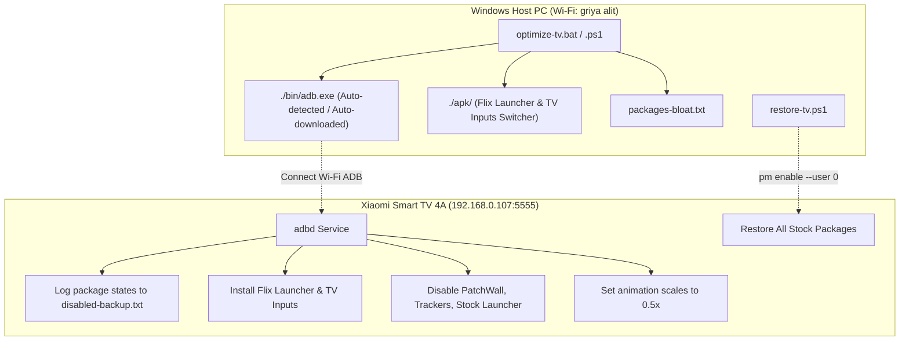

# Xiaomi Smart TV 4A Apple TV Experience Implementation Plan

> **For agentic workers:** REQUIRED SUB-SKILL: Use superpowers:subagent-driven-development (recommended) or superpowers:executing-plans to implement this plan task-by-task. Steps use checkbox (`- [ ]`) syntax for tracking.

**Goal:** Build a robust, 100% reversible Windows automation toolkit (`xiaomi-tv-debloat`) that transforms a Xiaomi Smart TV 4A (32", 1GB RAM) into a fast, ad-free, Apple TV-like media experience using ADB debloating, performance tweaks, Flix Launcher, and HDMI input retention.

**Architecture:** A lightweight Windows PowerShell/Batch toolkit that interfaces with the Xiaomi TV over Wi-Fi ADB (target IP: `192.168.0.107`). The toolkit verifies or downloads ADB platform-tools, creates a backup snapshot of current packages, installs Flix Launcher and TV Inputs Switcher, disables memory-hogging PatchWall and telemetry daemons in user space (`pm disable-user --user 0`), and sets UI animation scales to 0.5x for instant fluid response.

**Architecture Diagram:**



**Tech Stack:** Windows PowerShell 5.1+, Windows CMD Batch, Android Debug Bridge (ADB), Android TV 9.0 (Pie) package manager (`pm`) and system settings.

**Spec:** [2026-11-18-xiaomi-tv-4a-apple-tv-experience-design.md](file:///C:/Users/user/.gemini/antigravity/scratch/xiaomi-tv-debloat/docs/superpowers/specs/2026-11-18-xiaomi-tv-4a-apple-tv-experience-design.md)

## Global Constraints
- Target IP prefill: `192.168.0.107` (with prompt to confirm or edit).
- Non-root only: Never use `pm uninstall` or destructive wipes; use `pm disable-user --user 0` to preserve DRM Widevine L1.
- Retain Google Assistant (`com.google.android.katniss`) and Play Store framework untouched.
- Retain hardware HDMI/AV input switching capability via dedicated TV Inputs launcher shortcut.
- Must provide instant 1-click restore capability (`restore-tv.ps1`).

## Review Focus
1. TV IP unreachable or ADB unauthorized: Script prompts user to accept debugging prompt on TV screen without crashing.
2. Launcher crash prevention: Script validates Flix Launcher is installed before disabling `com.google.android.tvlauncher`.
3. Disconnect during execution: Script handles errors per package, logging failed items rather than aborting midway.
4. Input loss: Verifies TV Inputs shortcut is deployed before PatchWall is disabled.
5. Reversibility: Script creates timestamped backup log so `restore-tv.ps1` can restore exact previous state.

---

### Task 1: Scaffolding and Curated Package Manifests

**Files:**
- Create: `C:/Users/user/.gemini/antigravity/scratch/xiaomi-tv-debloat/packages-bloat.txt`
- Create: `C:/Users/user/.gemini/antigravity/scratch/xiaomi-tv-debloat/packages-protected.txt`

**Interfaces:**
- Consumes: Package list from Design Spec Section 4.1.
- Produces: Text manifests consumed by `optimize-tv.ps1` and `restore-tv.ps1`.

- [ ] **Step 1: Create `packages-bloat.txt`**
Populate `packages-bloat.txt` with verified Xiaomi PatchWall, telemetry, and stock launcher package names for Mi TV 4A 32":
```
com.duokan.videodaily
com.mitv.tvhome
com.xiaomi.mitv.tvpush.tvpushservice
com.xiaomi.mitv.upgrade
com.mitv.screensaver
com.xiaomi.screenrecorder
com.mitv.gallery
com.xiaomi.stat
com.miui.analytics
com.xiaomi.mitv.tracker
com.google.android.tvlauncher
com.google.android.tvrecommendations
```

- [ ] **Step 2: Create `packages-protected.txt`**
Populate `packages-protected.txt` as a hard safety guard:
```
com.google.android.katniss
com.android.vending
com.google.android.gms
com.google.android.syncadapters.contacts
com.android.providers.settings
```

- [ ] **Step 3: Verify package manifests syntax and paths**
Verify file exists and can be parsed as non-empty string array in PowerShell.

---

### Task 2: Core Windows Optimization Script (`optimize-tv.ps1`)

**Files:**
- Create: `C:/Users/user/.gemini/antigravity/scratch/xiaomi-tv-debloat/optimize-tv.ps1`

**Interfaces:**
- Consumes: `packages-bloat.txt`, `packages-protected.txt`, and user's TV IP (`192.168.0.107`).
- Produces: Automated Wi-Fi ADB connection, backup log `disabled-packages-backup.txt`, package debloating, and 0.5x animation speed settings.

- [ ] **Step 1: Implement ADB resolution and auto-downloader**
If `adb.exe` is not found in system PATH or `./bin/`, automatically download Google platform-tools zip into `./bin/` and extract `adb.exe`.

- [ ] **Step 2: Implement TV Wi-Fi Connection Routine**
Prompt user with default IP `192.168.0.107`, test `adb connect 192.168.0.107:5555`, handle `unauthorized` prompt instructions (asking user to check TV screen).

- [ ] **Step 3: Implement Safety Pre-check and Backup Logging**
Query `adb shell pm list packages -d` and record existing disabled packages to `backup-state.json`.

- [ ] **Step 4: Implement Launcher & TV Inputs Deployment**
Check if launcher APK exists in `./apk/` or download lightweight Flix Launcher & TV Inputs switcher APK; install via `adb install -r`.
Verify package is present on TV before proceeding to disable stock launcher.

- [ ] **Step 5: Implement Safe Debloat Execution**
Loop through `packages-bloat.txt`, check against `packages-protected.txt`, and run `adb shell pm disable-user --user 0 <pkg>`.

- [ ] **Step 6: Implement Apple TV UI Speed Tuning**
Run:
`adb shell settings put global window_animation_scale 0.5`
`adb shell settings put global transition_animation_scale 0.5`
`adb shell settings put global animator_duration_scale 0.5`

- [ ] **Step 7: Verification test of PowerShell script execution logic**
Run syntax check via PowerShell parser.

---

### Task 3: One-Click Instant Restore Script (`restore-tv.ps1`)

**Files:**
- Create: `C:/Users/user/.gemini/antigravity/scratch/xiaomi-tv-debloat/restore-tv.ps1`

**Interfaces:**
- Consumes: `packages-bloat.txt` or `disabled-packages-backup.txt`.
- Produces: Re-enables all disabled packages (`pm enable`) and restores default animation scales (1.0x).

- [ ] **Step 1: Implement Restore Connection & Package Re-enabling**
Connect to TV IP (`192.168.0.107`), read disabled packages list, and execute `adb shell pm enable <pkg>` for every package.

- [ ] **Step 2: Re-enable Stock Google TV Launcher and PatchWall**
Explicitly ensure `com.google.android.tvlauncher` and `com.mitv.tvhome` are restored to `enabled`.

- [ ] **Step 3: Reset Animation Scales to Stock 1.0x**
Execute `adb shell settings put global window_animation_scale 1.0`, etc.

- [ ] **Step 4: Syntax and Dry-Run Verification**
Verify script runs cleanly and outputs proper instructions.

---

### Task 4: Windows Batch Wrapper (`optimize-tv.bat` & `restore-tv.bat`)

**Files:**
- Create: `C:/Users/user/.gemini/antigravity/scratch/xiaomi-tv-debloat/optimize-tv.bat`
- Create: `C:/Users/user/.gemini/antigravity/scratch/xiaomi-tv-debloat/restore-tv.bat`

**Interfaces:**
- Consumes: User double-click action in Windows File Explorer.
- Produces: Executes PowerShell with `-ExecutionPolicy Bypass -File .\optimize-tv.ps1`.

- [ ] **Step 1: Create `optimize-tv.bat` with admin & execution policy bypass**
```cmd
@echo off
title Xiaomi Smart TV 4A Optimizer - Apple TV Experience
powershell -NoProfile -ExecutionPolicy Bypass -File "%~dp0optimize-tv.ps1"
pause
```

- [ ] **Step 2: Create `restore-tv.bat`**
```cmd
@echo off
title Xiaomi Smart TV 4A Restore Tool
powershell -NoProfile -ExecutionPolicy Bypass -File "%~dp0restore-tv.ps1"
pause
```

---

### Task 5: Step-by-Step User Guide (`README.md`)

**Files:**
- Create: `C:/Users/user/.gemini/antigravity/scratch/xiaomi-tv-debloat/README.md`

**Interfaces:**
- Consumes: Target IP (`192.168.0.107`), TV settings instructions, and troubleshooting tips.
- Produces: Comprehensive Indonesian documentation for the user.

- [ ] **Step 1: Write Guide on Enabling TV Developer Options & ADB**
Detail the exact 7-click sequence on Build Number in Settings > Device Preferences > About, followed by turning on USB Debugging.

- [ ] **Step 2: Write Execution & Customization Steps**
Explain how to run `optimize-tv.bat`, what happens on the TV screen, and how to use the new Flix Launcher and HDMI Switcher.

- [ ] **Step 3: Document SmartTube (Ad-Free, 60fps YouTube)**
Include recommendation and download link for SmartTube as the ideal lightweight companion for 1GB RAM Android TV.
