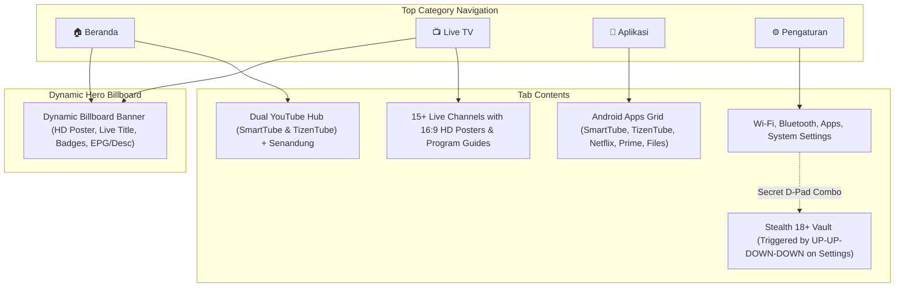

# Google TV Modern Redesign Implementation Plan

> **For agentic workers:** REQUIRED SUB-SKILL: Use superpowers:subagent-driven-development (recommended) or superpowers:executing-plans to implement this plan task-by-task. Steps use checkbox (`- [ ]`) syntax for tracking.

**Goal:** Transform Bumiayu TV Launcher into a premium Google TV / Modern Android TV interface with top category tabs, dynamic top billboard banner, Dual YouTube Hub (SmartTube & TizenTube Cobalt), 15+ live TV channels with HD thumbnails, and a stealth 18+ vault unlocked via secret remote combo and custom PIN.

**Architecture:**
The launcher uses a single-page web hub (`tv-hub/index.html`, `style.css`, `script.js`) hosted in an Android Leanback WebView (`tv-hub-android`). Navigation is driven by a 2D spatial D-Pad controller supporting Top Category Tabs (`Beranda`, `Live TV`, `Aplikasi`, `Pengaturan`). Focusing any card dynamically updates the Top Billboard with high-res art and metadata. The 18+ category is completely removed from the DOM/UI and accessible only via a secret D-Pad key combination (`UP, UP, DOWN, DOWN`) on the Settings tab, prompting a first-time PIN setup wizard.

**Architecture Diagram:**

**Tech Stack:**
- Frontend: Vanilla HTML5, CSS3 Grid/Flexbox, ES6 JavaScript, HLS.js
- Android TV: Kotlin 1.9+, Android SDK 28 (Pie / Android TV 9), Leanback WebView, ADB
- Hardware Optimization: Solid dark theme `#0a0b10`, zero `backdrop-filter: blur`, 60fps Mali-450 GPU compliance

**Spec:** [bumiayu-tv-modern-redesign.md](file:///C:/Users/user/.gemini/antigravity/brain/f1768e4a-b6e4-456b-83ee-7674f3c04326/bumiayu-tv-modern-redesign.md)

## Global Constraints
- Target Hardware: Xiaomi Smart TV 4A 32" (1GB RAM, Amlogic T962X / Mali-450 GPU, Android TV 9).
- Contrast Ratio: Minimum 7:1 for text against `#0a0b10` and `#161822`.
- Focus Affordance: `scale(1.06)` with neon-cyan `#38bdf8` specular rim.
- No `backdrop-filter: blur` in any CSS rule.
- Remote Key Navigation: Full D-Pad (Up, Down, Left, Right, Center/OK, Back).
- Active TV Device: `192.168.1.4:5555`.

---

## Tasks

### Task 1: Download & Install TizenTube Cobalt to Xiaomi TV via ADB

- [ ] **Step 1.1**: Fetch latest release metadata of `reisxd/TizenTubeCobalt` from GitHub API.
- [ ] **Step 1.2**: Download the ARM / Universal APK asset to `apk/TizenTubeCobalt.apk`.
- [ ] **Step 1.3**: Install `apk/TizenTubeCobalt.apk` to TV via `adb -s 192.168.1.4:5555 install -r`.
- [ ] **Step 1.4**: Verify installation with `adb shell pm list packages | grep tizentube`.
- [ ] **Step 1.5**: Commit the downloaded APK and installer update.

---

### Task 2: Overhaul HTML Structure with Google TV Tabs & Dynamic Billboard

- [ ] **Step 2.1**: Update `tv-hub/index.html` to declare Top Navigation Tabs (`#nav-tabs`: Beranda, Live TV, Aplikasi, Pengaturan).
- [ ] **Step 2.2**: Add `#hero-billboard` container with title, category badge, synopsis, and backdrop container.
- [ ] **Step 2.3**: Build Tab 1 (`#pane-home`): Dual YouTube Hub (SmartTube `org.smarttube.stable`, TizenTube Cobalt `com.github.reisxd.tizentubecobalt`), Senandung audio hub.
- [ ] **Step 2.4**: Build Tab 2 (`#pane-livetv`): 15+ curated channels (Kompas TV, Metro TV, TV One, Trans7, Trans TV, Net TV, Indosiar, SCTV, RCTI, CNN, CNBC, iNews, TVRI, NHK World, DW, France24, Al Jazeera) with 16:9 poster containers, live badges, and EPG program titles.
- [ ] **Step 2.5**: Build Tab 3 (`#pane-apps`): All installed apps grid with easy remote launcher cards.
- [ ] **Step 2.6**: Build Tab 4 (`#pane-settings`): Wi-Fi, Bluetooth, Kelola Aplikasi, Setelan Perangkat, and hidden vault anchor.
- [ ] **Step 2.7**: Add `<dialog id="vault-modal">` with first-time PIN Setup Wizard and D-Pad remote keypad.

---

### Task 3: Modernize CSS with Google TV Layout & 60fps Zero-Blur Optimization

- [ ] **Step 3.1**: Define Google TV design tokens (`--bg-canvas: #0a0b10`, `--surface-card: #161822`, `--focus-cyan: #38bdf8`, `--text-pri: #f8fafc`).
- [ ] **Step 3.2**: Style Top Navigation Bar with pill indicators and active underline state.
- [ ] **Step 3.3**: Style `#hero-billboard` with high-contrast text overlay and smooth opacity transition.
- [ ] **Step 3.4**: Style 16:9 channel cards with poster thumbnails, live indicators, and title overlays.
- [ ] **Step 3.5**: Implement focus styles (`transform: scale(1.06)`, `outline: 3px solid #38bdf8`, glow box-shadow).
- [ ] **Step 3.6**: Style PIN dialog with big numeric keypad for remote D-Pad navigation.
- [ ] **Step 3.7**: Verify zero `backdrop-filter` in `tv-hub/style.css`.

---

### Task 4: Implement Navigation Engine & Secret Remote Combo in JavaScript

- [ ] **Step 4.1**: Create channel data structure with 15+ channels, stream URLs, thumbnails, and EPG descriptions.
- [ ] **Step 4.2**: Implement Top Tab navigation and dynamic pane switching.
- [ ] **Step 4.3**: Implement Dynamic Billboard updater on focus change.
- [ ] **Step 4.4**: Implement Secret Combo listener (`UP, UP, DOWN, DOWN` on Settings tab) to open `#vault-modal`.
- [ ] **Step 4.5**: Implement First-Time PIN Setup wizard (create 4 digits, confirm, store in localStorage/bridge).
- [ ] **Step 4.6**: Implement HLS Video Player modal with remote controls (Back to exit, D-Pad Left/Right for channel switch).
- [ ] **Step 4.7**: Write unit tests in `tv-hub/test.js` and verify passing.

---

### Task 5: Sync Assets to Android Project, Build & Deploy APK

- [ ] **Step 5.1**: Update `MainActivity.kt` with package intents for TizenTube Cobalt and encrypted PIN storage bridge.
- [ ] **Step 5.2**: Synchronize all files from `tv-hub/` to `tv-hub-android/app/src/main/assets/hub/`.
- [ ] **Step 5.3**: Commit changes and trigger GitHub Actions build or local assemble.
- [ ] **Step 5.4**: Download fresh `BumiayuTVLauncher.apk` and install to TV via `adb -s 192.168.1.4:5555 install -r`.
- [ ] **Step 5.5**: Launch `com.bumiayu.tvlauncher/.MainActivity` on the TV.

---

### Task 6: Live TV Verification & Final Screenshot

- [ ] **Step 6.1**: Capture live screenshot via `adb shell screencap` from the TV.
- [ ] **Step 6.2**: Verify that Google TV Tabs, Dual YouTube Hub, 15+ TV channels, and Settings display properly.
- [ ] **Step 6.3**: Present the live screenshot to the user and confirm all requirements are met.
