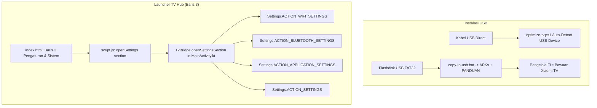

# USB Installation & TV Settings Integration Implementation Plan

> **For agentic workers:** REQUIRED SUB-SKILL: Use superpowers:subagent-driven-development (recommended) or superpowers:executing-plans to implement this plan task-by-task. Steps use checkbox (`- [ ]`) syntax for tracking.

**Goal:** Expand Bumiayu TV Launcher with dual USB installation capabilities (automatic ADB USB cable detection and an offline USB flashdisk preparation tool) and integrate a dedicated Row 3 Settings section (Wi-Fi, Bluetooth, Apps, Device) in the launcher dashboard.

**Architecture:**
- **USB Cable & Flashdisk Installer (`optimize-tv.ps1` & `copy-to-usb.bat`):** `optimize-tv.ps1` checks for direct USB-connected devices via `adb devices` before prompting for Wi-Fi IP, enabling zero-configuration cable installs. `copy-to-usb.bat` / `copy-to-usb.ps1` scans for plugged USB flash drives and copies APKs along with an offline TV file manager installation guide.
- **Android Settings Bridge (`MainActivity.kt`):** Extend `TvBridge` with `openSettingsSection(section: String)` mapping to Android `Settings.ACTION_WIFI_SETTINGS`, `ACTION_BLUETOOTH_SETTINGS`, `ACTION_APPLICATION_SETTINGS`, and `ACTION_SETTINGS`.
- **Row 3 Dashboard Settings UI (`tv-hub/index.html`, `tv-hub/script.js`, `tv-hub/assets/`):** A clean third row featuring Wi-Fi, Bluetooth, Kelola Aplikasi, and Pengaturan Perangkat cards with dedicated minimalist icons and seamless D-Pad spatial 2D navigation.

**Architecture Diagram:**

**Tech Stack:** PowerShell, Kotlin / Android SDK Settings Intents, Vanilla HTML5 / CSS3 / JavaScript.

**Spec:** [bumiayu-tv-usb-and-settings-design.md](file:///C:/Users/user/.gemini/antigravity/brain/f1768e4a-b6e4-456b-83ee-7674f3c04326/bumiayu-tv-usb-and-settings-design.md)

---

## Global Constraints
- Target Hardware: Xiaomi Smart TV 4A 32" (Android TV 9, 1GB RAM, GPU Mali-450).
- Pure lightweight aesthetics: solid `#0d0e12`, zero blur, `scale(1.06)` focus indicators.
- 100% remote D-Pad navigation across all 3 rows.

---

## Tasks

### Task 1: USB Installation Automation (Direct USB Cable ADB & Flashdisk USB Tool)
**Deliverables:**
- In `optimize-tv.ps1`:
  - Enhance connection logic: query `& $AdbCmd devices` for existing direct USB connections (e.g. devices without port `:5555`).
  - If found, automatically proceed with USB cable mode without prompting for Wi-Fi IP.
- Create `copy-to-usb.ps1` and `copy-to-usb.bat`:
  - Enumerate removable USB drives on the PC.
  - Copy `apk/BumiayuTVLauncher.apk` and `apk/smarttube_stable.apk` into the USB drive.
  - Create `PANDUAN_INSTALL_TV.txt` on the USB drive.

- [ ] Update `optimize-tv.ps1` with direct USB cable device auto-detection.
- [ ] Create `copy-to-usb.ps1` and `copy-to-usb.bat`.
- [ ] Test PowerShell syntax for both scripts.

### Task 2: Android WebView Bridge Settings Intents (`MainActivity.kt`)
**Deliverables:**
- In `tv-hub-android/app/src/main/java/com/bumiayu/tvlauncher/MainActivity.kt`:
  - Add `@JavascriptInterface fun openSettingsSection(section: String)` in `TvBridge`.
  - Handle sections: `wifi` -> `ACTION_WIFI_SETTINGS`, `bluetooth` -> `ACTION_BLUETOOTH_SETTINGS`, `apps` -> `ACTION_APPLICATION_SETTINGS`, `device` -> `ACTION_DEVICE_INFO_SETTINGS` / `ACTION_SETTINGS`.

- [ ] Update `MainActivity.kt` with `openSettingsSection`.

### Task 3: Settings Icons & Row 3 Launcher UI (`tv-hub/assets/`, `tv-hub/index.html`, `tv-hub/script.js`, `tv-hub/style.css`)
**Deliverables:**
- In `tv-hub/assets/`:
  - Generate clean minimalist icons: `wifi.png`, `bluetooth.png`, `apps.png`, `settings.png`.
- In `tv-hub/index.html`:
  - Add Row 3: `<section aria-labelledby="row-title-settings">` with 4 cards:
    - Wi-Fi & Jaringan (`onclick="openSettings('wifi')"`)
    - Bluetooth & Remote (`onclick="openSettings('bluetooth')"`)
    - Kelola Aplikasi (`onclick="openSettings('apps')"`)
    - Pengaturan Perangkat (`onclick="openSettings('device')"`)
- In `tv-hub/script.js`:
  - Implement `openSettings(section)` invoking `window.TvBridge.openSettingsSection(section)` with fallback toast.
- In `tv-hub/style.css`:
  - Adjust `.container` layout so all 3 rows scroll and navigate smoothly.

- [ ] Generate 4 new icon assets in `tv-hub/assets/`.
- [ ] Add Row 3 in `tv-hub/index.html`.
- [ ] Implement `openSettings(section)` in `tv-hub/script.js`.
- [ ] Ensure CSS styles handle 3 rows smoothly.

### Task 4: Synchronization, Testing, CI Build & Verification
**Deliverables:**
- Synchronize `tv-hub/` into `tv-hub-android/app/src/main/assets/hub/`.
- Update `tv-hub/test.js` to verify Row 3 Settings cards and USB script assets.
- Run `node tv-hub/test.js` ensuring 100% pass rate.
- Commit and push to GitHub repository `main`.
- Wait for GitHub Actions build #6, download compiled APK to `apk/BumiayuTVLauncher.apk`.

- [ ] Sync assets to Android project.
- [ ] Update `tv-hub/test.js` and run test suite.
- [ ] Commit and push to GitHub repository.
- [ ] Download latest APK from GitHub Actions artifact.
