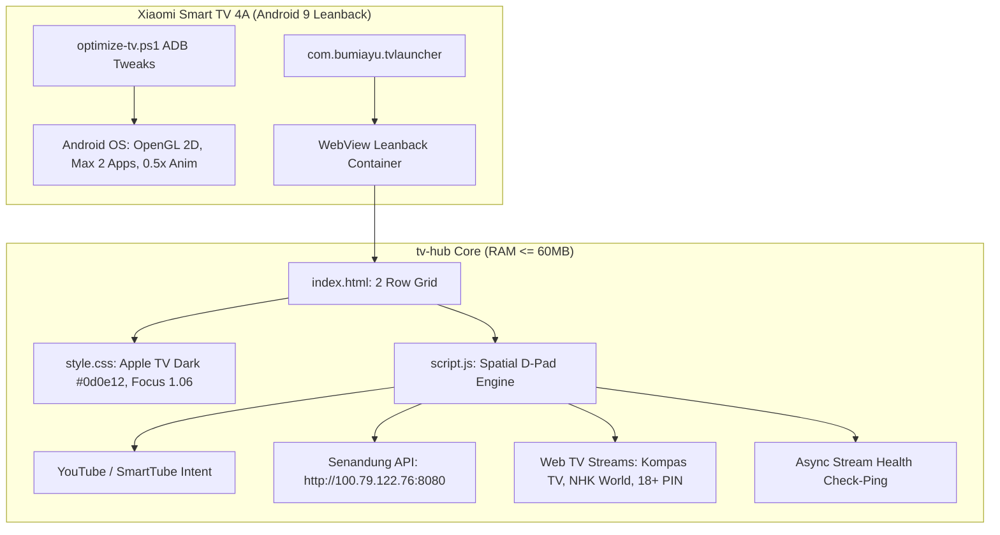

# Xiaomi Mi TV 4A 1GB RAM Optimization & Master Template Implementation Plan

> **For agentic workers:** REQUIRED SUB-SKILL: Use superpowers:subagent-driven-development (recommended) or superpowers:executing-plans to implement this plan task-by-task. Steps use checkbox (`- [ ]`) syntax for tracking.

**Goal:** Transform the Bumiayu TV project into an ultra-lean, luxury dark Apple TV launcher tailored for Xiaomi Smart TV 4A (1GB RAM, Mali-450 GPU) strictly adhering to the Antigravity Master Template (Sessions 0 to 5) with aggressive ADB tweaks, cloned YouTube identity, native D-Pad spatial navigation, Senandung music controller widget, async HLS stream health check, and integrated TV player.

**Architecture:**
- **OS & Hardware Tweaks (`optimize-tv.ps1` & `AndroidManifest.xml`):** Force OpenGL 2D hardware acceleration, limit background cache processes to 2, disable logcat background logging, set animation scale to 0.5x, and rebrand launcher application ID to `com.bumiayu.tvlauncher` with app label "YouTube" and official clone icon.
- **Minimal 3-File Web Core (`tv-hub/`):** Pure vanilla HTML5, CSS3, and JavaScript consisting strictly of `index.html`, `style.css`, and `script.js`.
- **Apple TV Luxury Dark UI (`tv-hub/style.css`):** Solid `#0d0e12` dark background, zero `backdrop-filter: blur()` or heavy particles, `16px` border-radius, scale `1.06` glowing `:focus` indicators, and high contrast $\ge 7:1$.
- **D-Pad Spatial Navigation & Features (`tv-hub/script.js`):** Native remote D-Pad navigation (Arrow keys, OK/Enter, Back), Senandung server API player controls, async stream check-ping with badges (🟢 Online, 🔴 Offline, 🟡 Checking), native `<dialog>` PIN modal for 18+ category, and fullscreen video overlay with Back key dismissal.

**Architecture Diagram:**

**Tech Stack:** Vanilla JavaScript (ES6+), HTML5 Video & Dialog, CSS3 (rgba, CSS transitions), Kotlin / Android WebView Leanback, PowerShell / ADB.

**Spec:** [bumiayu-tv-master-design.md](file:///C:/Users/user/.gemini/antigravity/brain/f1768e4a-b6e4-456b-83ee-7674f3c04326/bumiayu-tv-master-design.md)

---

## Global Constraints
- Target Hardware: Xiaomi Smart TV 4A 32" (Android TV 9, 1GB RAM, GPU Mali-450).
- Folder topography in `tv-hub/` strictly limited to: `index.html`, `style.css`, `script.js`, and `assets/`.
- No heavy `backdrop-filter: blur()` or continuous canvas animation loops; use solid `#0d0e12` and `rgba()` layers.
- 100% remote D-Pad navigation (ArrowUp, ArrowDown, ArrowLeft, ArrowRight, Enter/OK, Back/Esc).
- Antislop Rule: Mode DURING (clean aesthetic, purposeful contrast, high readability, zero AI slop gradients).

---

## Review Focus
1. D-Pad focus trapping in `<dialog id="adult-pin-dialog">` so focus does not escape behind modal while open.
2. Back button behavior in fullscreen player cleanly returns to launcher grid without closing app.
3. Fallback when Senandung server or stream URLs are unreachable (display clear offline indicators without crashing).
4. Seamless uninstallation of previous package `com.faisal.tvhub` before installing new `com.bumiayu.tvlauncher`.
5. Asset paths load reliably inside Android WebView `file:///android_asset/hub/`.

---

## Tasks

### Task 1: Android System Optimization (`optimize-tv.ps1`) & Android Package Identity / Manifest (`tv-hub-android/`)
**Deliverables:**
- In `optimize-tv.ps1`:
  - Add aggressive ADB optimizations:
    - `adb shell setprop debug.hwui.renderer opengl`
    - `adb shell settings put global max_cached_apps 2`
    - `adb shell setprop log.tag.all SILENT`
    - Verify animation scales (0.5x).
  - Update uninstallation / installation flow to remove `com.faisal.tvhub` if present and install `com.bumiayu.tvlauncher`.
- In `tv-hub-android/app/build.gradle.kts`:
  - Update `applicationId = "com.bumiayu.tvlauncher"` and `namespace = "com.bumiayu.tvlauncher"`.
- In `tv-hub-android/app/src/main/AndroidManifest.xml`:
  - Update package to `com.bumiayu.tvlauncher`, `android:label="YouTube"`, `android:icon="@drawable/ic_youtube_tv"`.
  - Ensure hardware acceleration is forced.
- In `tv-hub-android/app/src/main/res/drawable/ic_youtube_tv.xml`:
  - Create high quality clean vector drawable icon for YouTube clone.
- Update `MainActivity.kt` package declaration to `com.bumiayu.tvlauncher`.

- [ ] Update `optimize-tv.ps1` with OpenGL 2D, max_cached_apps 2, logcat SILENT, and package upgrade logic.
- [ ] Update `tv-hub-android/app/build.gradle.kts` with `com.bumiayu.tvlauncher`.
- [ ] Update `tv-hub-android/app/src/main/AndroidManifest.xml` with label "YouTube" and icon.
- [ ] Create `tv-hub-android/app/src/main/res/drawable/ic_youtube_tv.xml`.
- [ ] Update `MainActivity.kt` package and imports to `com.bumiayu.tvlauncher`.

### Task 2: Assets & Dark Theme CSS (`tv-hub/assets/`, `tv-hub/style.css`)
**Deliverables:**
- In `tv-hub/assets/`:
  - Create `youtube_tv.png` and `senandung.png` clean minimalist icon assets.
- In `tv-hub/style.css`:
  - Implement Apple TV Dark Mode `#0d0e12` base styles.
  - Grid rows and card layout (`.tv-card` min-width 240px, height 140px, border-radius 16px).
  - Spatial navigation focus effect (`.tv-card:focus` with `scale(1.06)`, border `#ffffff`, deep shadow).
  - Status badges (`.status-badge`, `.status-online`, `.status-offline`, `.status-checking`).
  - Native `<dialog>` styling for adult PIN modal (centered dark card, numeric keypad grid, glowing focus for remote D-Pad).
  - Fullscreen video player overlay styles (`.video-overlay`, auto-hiding OSD).
  - Strict compliance with Antislop DURING mode.

- [ ] Create `youtube_tv.png` and `senandung.png` in `tv-hub/assets/`.
- [ ] Write `tv-hub/style.css` matching Master Template Sesi 2 with PIN dialog and video player extensions.
- [ ] Verify CSS contrast ratios ($\ge 7:1$) and absence of heavy blur filters.

### Task 3: D-Pad Spatial Navigation, Senandung API, Health Checker & PIN Modal (`tv-hub/script.js`)
**Deliverables:**
- In `tv-hub/script.js`:
  - **Spatial Navigation Engine:**
    - Keydown listener handling D-Pad: ArrowLeft (37), ArrowRight (39), ArrowUp (38), ArrowDown (40), Enter/OK (13, 23), Back/Esc (27, 4).
    - Grid 2D navigation (switching between Row 1 and Row 2, wrapping/clamping gracefully).
    - Initial focus on the first card upon DOM ready.
  - **Senandung API Controller:**
    - `controlSenandung(action)` with endpoint `http://100.79.122.76:8080/api/player/${action}` (POST JSON).
    - Visual toast / feedback on the Senandung card when toggled.
  - **HLS Stream Health Checker:**
    - `checkStreamStatus(url)` via `fetch(url, { method: 'HEAD', mode: 'no-cors' })` with 3s timeout.
    - `initChannelChecker()` scanning all `.tv-card[data-stream]` and updating `.status-badge`.
  - **PIN Dialog for 18+ Category:**
    - `openAdultPinDialog(streamUrl)` opening native `<dialog id="adult-pin-dialog">`.
    - D-Pad controllable numeric keypad (0-9, Backspace, Batal, Masuk).
    - PIN validation against `1234` (or stored PIN).
  - **Fullscreen Player Overlay:**
    - `playStream(url, title)` opening video overlay, loading HLS/MP4, and auto-playing.
    - Back key closes player cleanly and returns focus to the clicked card.

- [ ] Implement spatial 2D D-Pad navigation engine in `tv-hub/script.js`.
- [ ] Implement Senandung player API integration.
- [ ] Implement async `checkStreamStatus` and `initChannelChecker`.
- [ ] Implement remote PIN modal dialog logic for 18+ category.
- [ ] Implement fullscreen video overlay player with Back key dismissal.

### Task 4: Lightweight Minimal DOM (`tv-hub/index.html`), Cleanup & Android Sync
**Deliverables:**
- In `tv-hub/index.html`:
  - Minimalist Apple TV DOM matching Master Template Sesi 5:
    - Container with Row 1 (Hiburan & Ekosistem: YouTube clone & Senandung widget).
    - Row 2 (Saluran Web TV Live: Kompas TV, NHK World, Kategori 18+ Terkunci).
  - Embedded `<dialog id="adult-pin-dialog">` for remote PIN input.
  - Embedded `
` with `<video id="main-video">`.
- File Topography Cleanup:
  - Remove obsolete files in `tv-hub/` (`app.js`, `webtv.html`, `webtv.js`, `themes.js`, `styles.css`) per Sesi 0 specification.
- Asset Synchronization:
  - Synchronize `tv-hub/` contents (`index.html`, `style.css`, `script.js`, `assets/`) to `tv-hub-android/app/src/main/assets/hub/`.

- [ ] Write `tv-hub/index.html` adhering to Master Template Sesi 5.
- [ ] Clean up redundant files in `tv-hub/` to leave exactly the 3-file core + assets.
- [ ] Sync all files from `tv-hub/` into `tv-hub-android/app/src/main/assets/hub/`.

### Task 5: Unit Testing, GitHub Push, CI Build & Deployment to Xiaomi TV
**Deliverables:**
- In `tv-hub/test.js`:
  - Unit tests verifying:
    - Sesi 0 topography compliance (only expected files present).
    - Sesi 2 CSS selectors and focus rules.
    - Sesi 3 D-Pad keydown navigation logic.
    - Sesi 4 Stream health check status logic and PIN verification.
    - Sesi 5 DOM structure and attributes.
- Execution & CI:
  - Run `node tv-hub/test.js` to ensure 100% pass rate.
  - Commit all changes and push to `origin main` on `faisalfa123/bumiayu-tv`.
  - Monitor GitHub Actions workflow run to success.
  - Download newly compiled `BumiayuTVLauncher-APK` and update local `apk/BumiayuTVLauncher.apk`.
  - Deploy to Xiaomi TV via ADB:
    - Uninstall `com.faisal.tvhub`.
    - Install `apk/BumiayuTVLauncher.apk` (`com.bumiayu.tvlauncher`).
    - Launch `.MainActivity` and verify visually via `screencap`.

- [ ] Write comprehensive unit tests in `tv-hub/test.js`.
- [ ] Run `node tv-hub/test.js` and verify all tests pass.
- [ ] Commit and push to GitHub repository `main` branch.
- [ ] Monitor GitHub Actions workflow run to completion.
- [ ] Download artifact APK and install onto Xiaomi TV 4A via ADB.
- [ ] Verify launcher running and capture screenshot from TV.
