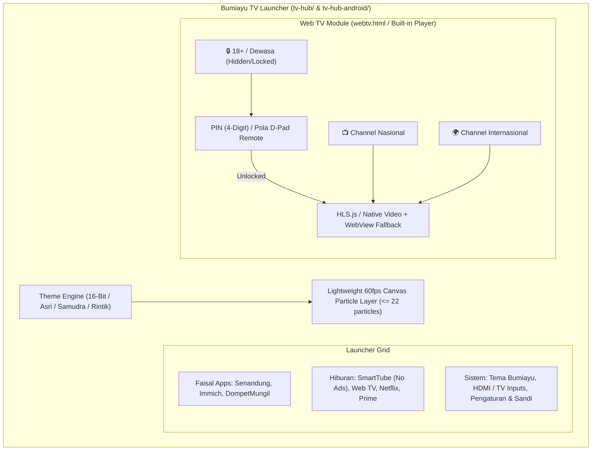

# Design Document: Bumiayu TV Launcher

## 1. Intent & The "Why"
Transform **Xiaomi Smart TV 4A (32", 1 GB RAM)** into a personalized, expressive, and silky-smooth **Bumiayu TV Launcher** that combines:
1. **4 Switchable Anime Retro Themes:**
   - **Bumiayu 16-Bit Pixel Art:** Retro anime pixel-art aesthetic, crisp pixel-inspired borders, warm CRT-nostalgic palette, starry night canvas.
   - **Bumiayu Asri:** Aesthetic autumn golden hour in Bumiayu, warm amber/terracotta tones, gentle falling autumn leaves animation.
   - **Bumiayu Samudra:** Serene ocean aesthetic, deep coastal blues/teals, soft floating bubbles & subtle wave shimmer.
   - **Bumiayu Rintik:** Cozy rainy evening atmosphere, cool misty slate-blue palette, smooth diagonal raindrop particles.
2. **SmartTube Integration:** Seamless one-click launch and automated deployment of **SmartTube Stable** (ad-free 60fps YouTube).
3. **Integrated Web TV (2 Main Modes + Locked 18+ Category):**
   - **Channel Nasional** & **Channel Internasional**: Built-in HLS/M3U stream player + WebView fallback for live TV web streams, plus editable M3U/channel list in Settings.
   - **18+ / Dewasa Category:** Protected by a user-configurable **4-digit PIN OR D-Pad Remote Pattern** (e.g., `Up-Up-Down-Right`), with an option to hide the 18+ tab from the main UI completely until unlocked.
4. **Faisal's Self-Hosted Ecosystem (`faisalfa123`):**
   - **Senandung**, **Immich**, and **DompetMungil** with D-Pad Virtual Pointer and graceful offline error + server re-configuration UI.

---

## 2. Architecture & Component Flow

---

## 3. Detailed Design Decisions

### 3.1 Theme System & 60fps Mali-450 Optimization
- **Theme Persistence:** Stored in `localStorage` (`bumiayu_theme`) and synced across `index.html`, `webtv.html`, and `error.html`.
- **Quick Switcher:** A dedicated **"Tema Bumiayu"** card (plus a top-bar pill) opens a clean visual selector for:
  1. `pixel` (**Bumiayu 16-Bit Pixel Art**)
  2. `asri` (**Bumiayu Asri — Musim Gugur**)
  3. `samudra` (**Bumiayu Samudra — Nuansa Laut**)
  4. `rintik` (**Bumiayu Rintik — Musim Penghujan**)
- **Lightweight Particle Engine (`<canvas>`):** Uses a single `requestAnimationFrame` loop capped at ~20–24 simple geometric particles (falling leaves, raindrops, ocean bubbles, twinkling pixel stars) — zero heavy DOM nodes or live `backdrop-filter: blur()`, ensuring smooth 60fps on Xiaomi TV 4A's Mali-450 GPU.

### 3.2 Web TV (Nasional, Internasional, & Locked 18+)
- **Dual Playback Engine:**
  - **Direct HLS/Video Streams (`.m3u8` / `.mp4`):** Played directly inside a clean, full-screen dark TV video player (`<video>` + native/HLS.js) with D-Pad channel up/down and favorite toggling.
  - **Web Stream Fallback:** Opens web-based TV portals inside `WebAppActivity` with Virtual Pointer support.
- **Channel & M3U Management:**
  - Pre-populated with legal public Indonesian & International channels and supports importing custom M3U playlists or adding individual channels in Settings.
- **18+ / Dewasa Security (`LockManager`):**
  - Default state: **Locked** (and optionally hidden from tab bar until unlocked).
  - Supports **2 Lock Modes** configurable in Settings:
    1. **PIN 4-Digit** (on-screen D-Pad numeric pad).
    2. **Pola Arah Remote (D-Pad Sequence)** (4 to 6 directional presses, e.g., `↑ ↑ ↓ →`).
  - Passcode/pattern is stored as a hash in `localStorage` — never stored as plain visible text.
  - Auto-locks again when exiting Web TV.

### 3.3 Saran & Masukan Tambahan (Included in Design)
1. **Mode Screensaver Ambient ("Layar Santai Bumiayu"):** Tombol/opsi untuk menyembunyikan seluruh kartu menu sehingga TV menampilkan jam anime retro + animasi musim gugur/hujan/laut sebagai pajangan ruangan.
2. **Channel Favorit & Zapping Cepat:** Menandai channel favorit agar muncul di paling atas daftar Web TV.
3. **Indikator RAM / Status Sistem:** Badge status ringan di header.

---

## 4. Build & Deployment Strategy
- **Local Preview:** Open `tv-hub/index.html` directly in any browser on Windows to test all 4 themes, Web TV, PIN/Pattern lock, and animations immediately.
- **Android TV APK:** Compiled automatically via **GitHub Actions** (`.github/workflows/build-apk.yml`) producing `BumiayuTVLauncher-APK` (`app-debug.apk`), then installed to the Xiaomi TV (`192.168.1.5`) via `optimize-tv.bat`.
