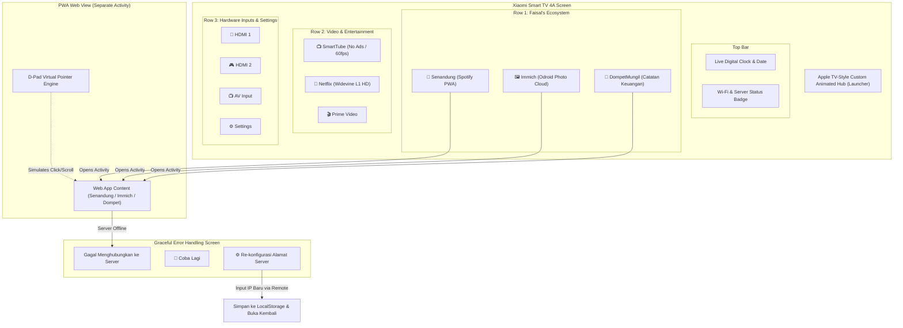

# Design Document: Custom Animated Apple TV Hub & Faisal Ecosystem Integration

## 1. Intent & The "Why"
The user wants to transform their **Xiaomi Smart TV 4A (32", 1 GB RAM)** from a sluggish stock television into a personalized, beautiful, and fluid media center. This design unifies:
1. **Faisal's Self-Hosted App Ecosystem:** Directly integrating `Senandung` (music streaming PWA), `Immich` (photo cloud on Odroid C2/STB), and `DompetMungil` (finance PWA).
2. **Virtual Mouse / Remote Pointer:** An integrated virtual cursor layer so the standard Xiaomi TV remote D-Pad can click, scroll, and interact seamlessly with touch/mouse web apps.
3. **Resilient Network Handling:** When local SBC servers are offline or URLs change, displaying a polished Apple TV-style error card with an on-screen **"Re-konfigurasi Alamat Server"** modal rather than generic webview crash pages.
4. **Beautiful Apple TV (tvOS) Visuals & Motion:** Silky 60fps focus-scaling card animations, dark glass aesthetic, live clock/date, and flawless remote navigation.
5. **Ad-Free YouTube Experience:** Native integration and automatic deployment of **SmartTube Stable**.
6. **Hardware Input Retention:** Dedicated tiles for HDMI 1, HDMI 2, AV, and system settings.

---

## 2. Goals, Non-Goals, and Anti-Goals

### Goals
- Deliver a dedicated **Custom Hub / Launcher APK** for Android TV with `android.intent.category.HOME` intent.
- Implement Apple TV-inspired animated UI (smooth focus scaling, subtle gradients, dark mode, live clock).
- Integrate direct launchers for:
  - **Faisal Apps:** Senandung, Immich, DompetMungil (with configurable local IP/port & on-screen fallback settings).
  - **Remote D-Pad Virtual Pointer:** Toggleable virtual cursor for interacting with web elements in PWA apps using the TV remote.
  - **Ad-Free Media:** SmartTube Stable (auto-downloaded from official release).
  - **Streaming & Inputs:** Netflix, Prime Video, HDMI 1, HDMI 2, AV.
- Isolate app lifecycles: Each web app launches in a separate activity so pressing Back immediately terminates it and reclaims memory for the TV.
- Ultra-lightweight footprint tuned for 1GB RAM and Mali-450 GPU (avoiding heavy live GPU blur shaders).

### Non-Goals
- Modifying backend server logic inside `Senandung`, `Immich`, or `DompetMungil`.
- Re-encoding or transposing video streams (handled natively by the TV's hardware decoders).

### Anti-Goals
- Requiring an external mouse/keyboard (the integrated virtual pointer ensures 100% remote control).
- Crashing with white screens when the server is unreachable.
- Memory leaks that cause the TV launcher to crash when multitasking.

---

## 3. Architecture & User Experience Flow

---

## 4. Detailed Component Design

### 4.1 Custom Animated Hub UI & Motion Engine
- **Aesthetic:** Dark tvOS background (#0e1117) with layered translucent cards (`background: rgba(255,255,255,0.07); border: 1px solid rgba(255,255,255,0.12)`).
- **Focus Motion:** When a card receives D-pad focus, it scales up smoothly (`transform: scale(1.08)` with `cubic-bezier(0.2, 0.8, 0.2, 1.0)` over 180ms) with a soft white glow border and label zoom.
- **Hardware Input Switching:** Triggers native Android TV Input framework (`android.media.tv.action.VIEW_INPUTS` or passthrough URI) so HDMI 1, 2, and AV remain 100% accessible.

### 4.2 Faisal Apps Wrapper & Virtual Pointer
- **Virtual Pointer Mode:** When navigating web pages (like DompetMungil form inputs or Immich photo thumbnails), pressing the D-pad moves a visible smooth circular pointer. Pressing `OK` dispatches touch/click events to the exact coordinate under the cursor.
- **Error Interceptor:** If the WebView encounters connection refused or HTTP timeout:
  - Displays a clean dark card: *"Tidak dapat terhubung ke [Nama Aplikasi] di http://..."*.
  - Offers **"Coba Lagi (Retry)"** and **"Re-konfigurasi Alamat Server"**.
  - Selecting Re-konfigurasi opens an on-screen dialog to enter the new IP and port directly from the TV remote.

### 4.3 SmartTube Integration
- Script automatically downloads official release: `https://github.com/yuliskov/SmartTube/releases/latest/download/smarttube_stable.apk`.
- Installs with `adb install -r -d ./apk/smarttube_stable.apk`.
- Hub card launches package: `com.teamsmart.videomanager.tv`.

---

## 5. Implementation Deliverables
1. **Custom Hub Project (`tv-hub/`):**
   - High-performance, lightweight Android TV HTML5/Capacitor application bundle with native remote D-pad spatial navigation, Apple TV focus animations, error interceptor, and server re-configuration dialog.
2. **Toolkit Upgrades (`optimize-tv.ps1` & `.bat`):**
   - Auto-download SmartTube Stable.
   - Interactive prompt to pre-fill the SBC/Odroid C2 server IP.
   - Build/Deploy the Custom Hub APK to the TV via ADB (`192.168.1.5:5555`).
   - Set the Custom Hub as the primary Home Launcher.
