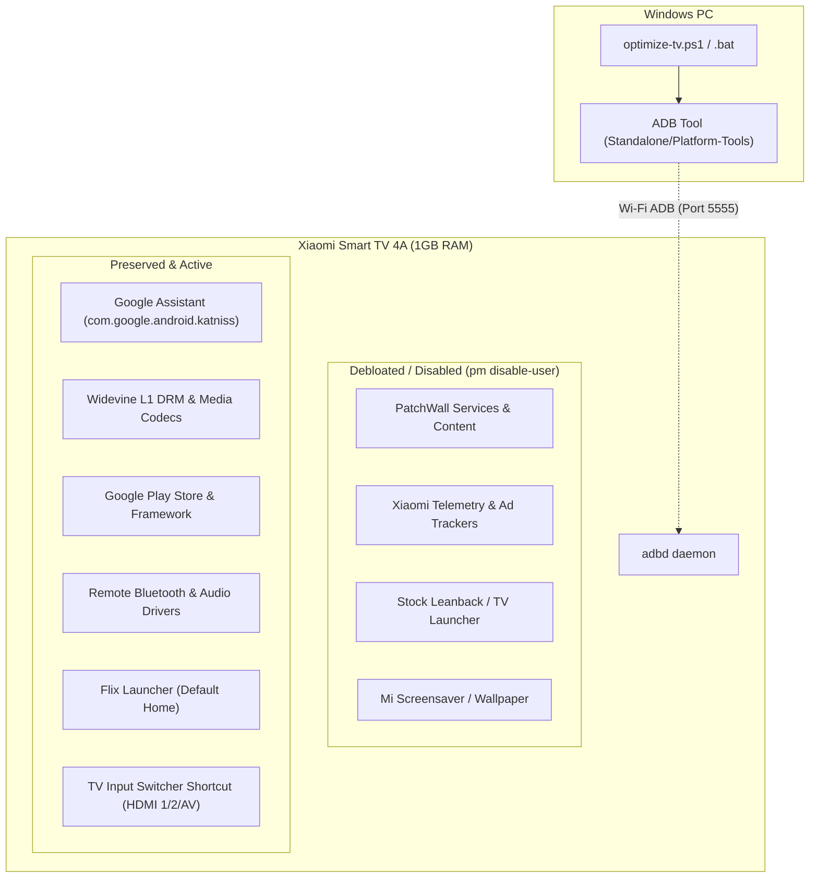

# Design Document: Xiaomi Smart TV 4A (32" 1GB RAM) — Apple TV Experience Optimization

## 1. Intent & The "Why"
Xiaomi Smart TV 4A 32" suffers from hardware constraints—primarily its **1 GB RAM** paired with a quad-core Amlogic processor and 8 GB storage. Out of the box, Xiaomi's PatchWall ecosystem, background analytics, ad pushers, and Google TV Home services consume over 75-80% of system RAM. This causes:
- 5–10 second home screen reload delays.
- Stuttering animations and navigation lag.
- Sudden app terminations during multitasking.
- Aggressive promotional banners and ad popups.

The objective is to deliver an **Apple TV (tvOS)-like experience**:
1. **Zero Ads & Clutter:** Clean, distraction-free home screen.
2. **Snappy & Fluid Response:** Freeing up 250MB–350MB of RAM, reducing animation latency, and ensuring instant app switching.
3. **Safety First:** 100% reversible, non-root, retaining Widevine L1 DRM (Netflix & Prime Video remain HD) and preserving Google Voice Assistant remote functionality.
4. **Hardware Usability:** Ensuring HDMI 1, HDMI 2, and AV inputs remain accessible even without PatchWall.

---

## 2. Goals, Non-Goals, and Anti-Goals

### Goals
- Free up maximum available RAM on the 1GB model by disabling non-essential background processes.
- Replace heavy Google TV Launcher and Xiaomi PatchWall with **Flix Launcher** (100% Free & Open-Source, Kotlin, < 1 MB).
- Keep Google Voice Assistant / Microphone button on the Xiaomi remote fully operational (`com.google.android.katniss`).
- Provide an easy-to-use **TV Inputs** launcher shortcut so users can switch seamlessly between HDMI 1, HDMI 2, and AV.
- Deliver an interactive, one-click PowerShell/Batch toolkit for Windows users to connect via Wi-Fi ADB, apply tweaks, and restore instantly if desired.

### Non-Goals
- Flashing custom firmware or rooting (which permanently breaks Widevine L1 DRM for Netflix).
- Removing core Android TV system libraries or Play Store framework needed for app compatibility.

### Anti-Goals (What would make this a failure)
- Breaking Netflix, Disney+ Hotstar, or Prime Video playback.
- Losing access to HDMI console/set-top box input switching.
- Breaking the TV remote controller pairing or the physical power/volume controls.
- Bricking the TV or creating an unrecoverable boot loop.

---

## 3. Approaches Considered

| Approach | Pros | Cons | Verdict |
| :--- | :--- | :--- | :--- |
| **A. Safe ADB Debloat + Flix Launcher + TV Inputs Shortcut (Recommended)** | Zero risk; no root; preserves Widevine L1 DRM; 100% reversible via `pm enable`; frees ~300MB RAM; mic remote remains functional; HDMI preserved. | Requires a PC on same Wi-Fi to run ADB once. | **SELECTED by User** |
| **B. Projectivy Launcher (Freemium)** | Modern look with Apple TV presets. | User specifically requested a 100% free alternative without premium upsells. | Rejected in favor of Flix Launcher |
| **C. Deep Root / Custom ROM Flashing** | Complete eradication of MIUI/PatchWall code. | High brick risk on Xiaomi TV boards, destroys DRM keys (Netflix drops to 480p or breaks). | Rejected (High Risk) |
| **D. In-TV Settings Only (No ADB)** | No computer needed. | Very limited impact; PatchWall and analytics remain resident in RAM. | Insufficient |

---

## 4. Architectural Design & Package Curation

### 4.1 Debloat Package Matrix (Safe for Mi TV 4A 32")
The script will target user-space disabling (`pm disable-user --user 0 <package>`):

1. **Xiaomi PatchWall & Content Pushers:**
   - `com.duokan.videodaily` (PatchWall daily recommendations)
   - `com.mitv.tvhome` (PatchWall Home Interface)
   - `com.xiaomi.mitv.tvpush.tvpushservice` (PatchWall push ads)
   - `com.xiaomi.mitv.upgrade` (MiTV update nag)
   - `com.mitv.screensaver` (Heavy screensaver)
   - `com.xiaomi.screenrecorder` (Mi screen recorder)
   - `com.mitv.gallery` (Stock gallery)

2. **Xiaomi Telemetry & Analytics:**
   - `com.xiaomi.stat` (Xiaomi Statistics daemon)
   - `com.miui.analytics` (MIUI analytics)
   - `com.xiaomi.mitv.tracker` (Tracker service)

3. **Heavy Stock Launcher & Ad Channels:**
   - `com.google.android.tvlauncher` (Replaced by Flix Launcher)
   - `com.google.android.tvrecommendations` (Background recommendation generator)

4. **Retained & Protected Packages (DO NOT DISABLE):**
   - `com.google.android.katniss` (Google Assistant / Remote Mic)
   - `com.android.vending` (Google Play Store)
   - `com.google.android.gms` (Google Play Services)
   - Bluetooth, Audio, HDMI input HAL, and Display drivers.

### 4.2 HDMI & Hardware Input Access
Because PatchWall (`com.mitv.tvhome`) traditionally holds the HDMI source tiles, disabling it without a replacement leaves the user unable to access HDMI 1, HDMI 2, or AV.
- **Solution:** The script installs a lightweight standalone TV Inputs shortcut application (`TV Inputs / Source Switcher`, <100 KB) which directly triggers the native Android TV hardware input selection dialog or provides standard app icons on the Flix Launcher home screen.

### 4.3 System Performance Tuning (via ADB Settings)
To replicate the instantaneous Apple TV feel:
- `window_animation_scale` = `0.5`
- `transition_animation_scale` = `0.5`
- `animator_duration_scale` = `0.5`
- RAM protection: Eliminate background bloat daemons rather than enforcing hard process limits that break multitasking and Google Assistant voice searches.

---

## 5. Deliverables & Tooling Structure
The optimization toolkit will be packaged into `C:\Users\user\.gemini\antigravity\scratch\xiaomi-tv-debloat\`:
1. `optimize-tv.ps1`: Interactive PowerShell wizard for Windows (checks ADB, auto-connects to TV IP, downloads prerequisites if missing, installs Flix Launcher and TV Inputs shortcut, disables bloat, applies performance tuning, and creates a backup log).
2. `restore-tv.ps1`: 1-click restore script to re-enable all original packages and restore stock settings.
3. `optimize-tv.bat`: Windows CMD wrapper for double-click execution.
4. `packages-bloat.txt`: Transparent, editable list of packages to disable.
5. `README.md`: Clear step-by-step documentation in Indonesian and English on enabling Developer Options & USB/Wi-Fi Debugging on the TV.

---

## 6. Review Focus & Risk Mitigations
1. **Network Disconnect during ADB:** Script handles timeout and reconnection gracefully.
2. **Launcher Safety Check:** Script verifies Flix Launcher is successfully installed on the TV before disabling `com.google.android.tvlauncher`, preventing any black-screen boot state.
3. **HDMI Access Guaranteed:** TV Inputs shortcut is verified installed before disabling PatchWall.
4. **Remote Microphone:** Google Assistant package is explicitly excluded from the debloat list.
5. **Full Reversibility:** Every disabled package is logged, and running `restore-tv.ps1` instantly runs `pm enable` for all of them.
